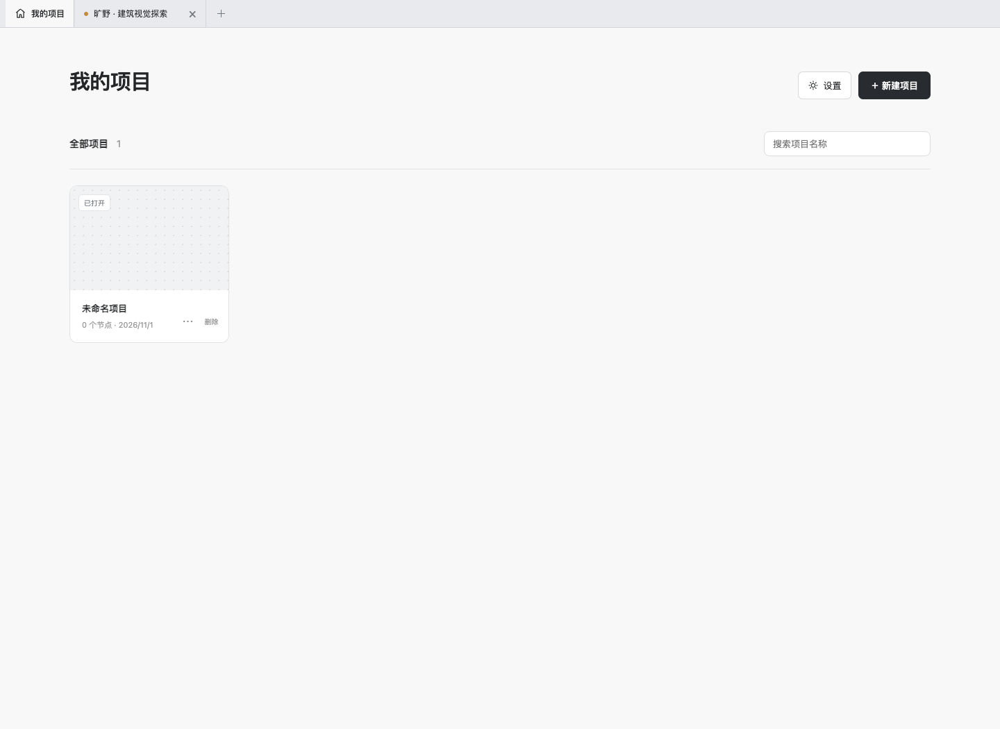
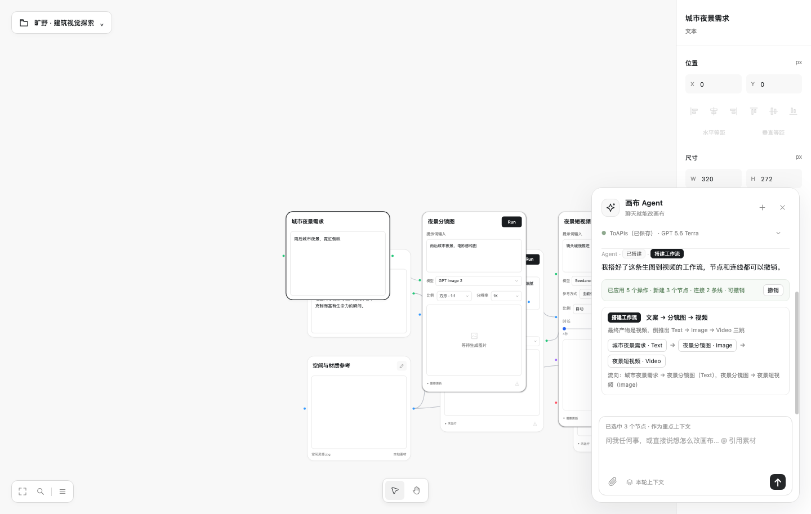
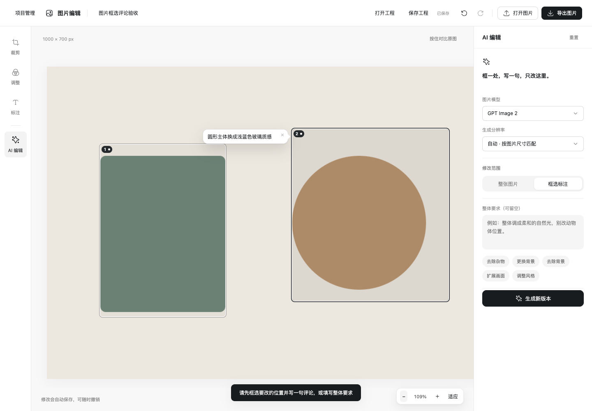

# Flow Studio · 本地 AI 创作画布

Flow Studio 是一款面向创作者的桌面 AI 工作台：把 Agent 规划、可视化画布、图片编辑、视频剪辑、素材准备和语音生成放进同一条工作流。

你可以从一个想法开始，让 Agent 拆解任务、调用已配置的模型和工具，再在画布与编辑器中继续修改、组合、导出，最后把完整项目保存在本机。

  <a href="https://github.com/Wauuuuuu/flow-studio-releases/releases/latest"><strong>下载 Terra</strong></a>
  ·
  <a href="https://github.com/Wauuuuuu/flow-studio-releases/releases"><strong>查看所有版本</strong></a>

## 产品亮点

- **Agent 与画布协同**：用规划卡把复杂任务拆成可理解、可回看的步骤；节点、连线和结果都保留在同一张画布上。
- **多模态创作**：统一处理文本、图片、视频、音频和素材准备，支持从灵感、参考资料到成片的连续工作流。
- **模型与服务商可配置**：在 API 管理中接入自己的文本、图片、视频和音频服务；节点可单独选择渠道与模型，不绑定单一供应商。
- **图片编辑更适合精修**：裁切、扩图、旋转、翻转、标注、局部修改和画面调整可以在同一编辑器中完成，批注与原图内容保持清晰分离。
- **视频编辑一体化**：时间线、素材封面、比例、字幕、曲线变速、旁白与 AI 素材生成连在一起，适合从片段整理到成片导出。
- **高分辨率导出**：支持 720P、1080P 与 4K 导出，工程参数、渲染和码率保持一致。
- **本地优先**：画布、项目、任务记录、API 配置和下载位置保存在本机；安装包不包含用户数据、API Key 或签名私钥。
- **跨平台桌面体验**：macOS Apple Silicon 与 Windows x64 使用同一套产品能力和冻结源码构建。
- **安全更新链路**：GitHub Release 提供安装包与 `latest.json`，更新前校验签名、文件大小与 SHA-256，下载完成后在下次启动安装。

## 界面一览

### Home 与项目入口

Home 集中放置项目、最近工作和设置入口。首次使用可从「设置 → API 管理」接入自己的模型服务。

### Agent 规划与画布

Agent 会先把任务拆成规划步骤，再把节点、工具调用和生成结果组织到画布中。你可以逐步检查、重跑、编辑和继续扩展。

### 图片标注与编辑

图片编辑器支持标注、评论、选区和精细缩放，适合做视觉反馈、局部修改和交付前检查。

## 下载与安装

请进入 [最新 Release](https://github.com/Wauuuuuu/flow-studio-releases/releases/latest)：

- **macOS**：下载 `Terra-macOS-arm64.dmg`，打开后将应用拖入 Applications。
- **Windows**：优先下载 `Terra-Windows-x64-Setup.exe`；也可以下载 `Terra-Windows-x64.zip`，完整解压后运行。
- 安装包已经包含运行环境，不需要另行安装 Node.js。

## 自动更新

安装后打开 **Home → 设置 → 软件更新**。应用会读取：

`https://github.com/Wauuuuuu/flow-studio-releases/releases/latest/download/latest.json`

发现新版本后，应用会下载对应平台安装包，完成签名、大小和 SHA-256 校验，并在下一次启动时安装。后续 Release 继续使用同一更新通道，因此用户无需手动更换更新地址。

## 数据与隐私

- 用户数据目录：macOS 为 `~/.forma-canvas`，Windows 为 `%USERPROFILE%\\.forma-canvas`。
- 项目、画布、素材引用、任务记录和 API 配置默认保存在本机。
- API Key 由用户在本机配置，不写入公开仓库或安装包。
- 本仓库用于产品分发，不是源码开源仓库。

## 当前发布

当前公开版本名为 **Terra**。发布说明、安装包、校验信息和自动更新清单都在 [GitHub Releases](https://github.com/Wauuuuuu/flow-studio-releases/releases) 中维护。

## 反馈

欢迎通过 [Issues](https://github.com/Wauuuuuu/flow-studio-releases/issues) 反馈问题或提出建议。提交问题时请尽量附上操作步骤、系统平台和相关截图；不要上传 API Key、用户数据或私密项目文件。
